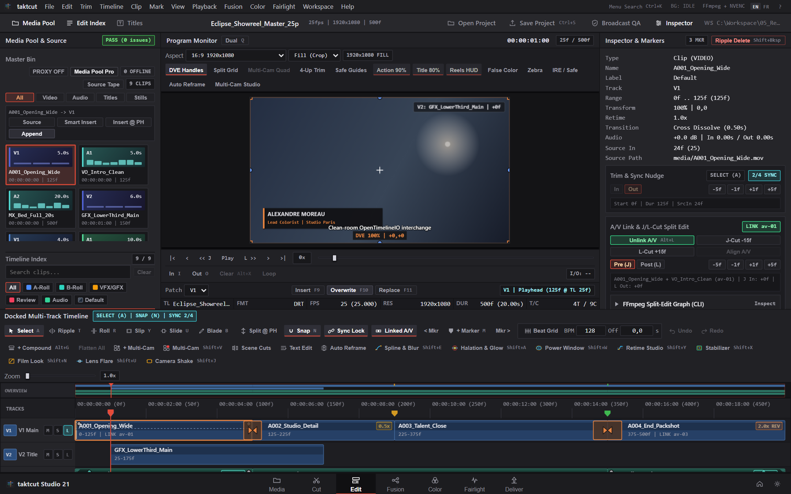

# taktcut

[](https://github.com/eldertek/taktcut/actions/workflows/ci.yml)
[](https://github.com/eldertek/taktcut/releases/tag/v0.1.22)
[](https://www.python.org/downloads/)
[](LICENSE)

Clean-room OpenTimelineIO interchange, DaVinci-style NLE Studio GUI, Auto-Reframe & Social Aspect Ratio Crop (`9:16`, `1:1`, `4:5`, `4:3`, `16:9`), Clip Retime Speed & Reverse (`0.25x` to `4.0x` + Reverse + Audio Pitch), Clip Video & Audio Fades (Dip-to-Black & Ramp), Lower-Third & Title Overlay, DaVinci Timeline Index (Clip Search & Color Filter), Clip Color Labels (A-Roll / B-Roll / VFX / Review / Audio), ASC CDL / `.cube` color pipeline, 20 Boris FX Sapphire-inspired FX, Fairlight Loudness & Dialogue EQ, SMPTE Timecode Burn-In & Client-Review Watermark, Deliver `export_fps` + Broadcast Deinterlace (`yadif`), Live Estimated Export File Size, Audio-Only Master Export (WAV24 / MP3-320 / AAC-256), FCPXML 1.10 Round-Trip Export (`.fcpxml`), CMX 3600 EDL Round-Trip Export (`.edl`), YouTube Chapters / FFMETADATA export, deterministic FFmpeg/NVENC rendering, and broadcast QA toolkit with local/remote execution, CLI, and MCP server.

`taktcut` (`v0.1.22`) inspects `.drp`, `.drt`, `.fcpxml`, and `.otio`/`.otioz` exports, provides a 6-page NLE workstation (**Timeline**, **FX**, **Titles**, **Color**, **Deliver**, **Broadcast QA**), bakes ASC CDL grades into `.cube` 3D LUTs, renders Rec.709 deliverables via local FFmpeg/`NVENC` or a **Remote GPU Render Node (`NVENC`)**, and runs an EBU R128 + faststart QA gate without opening a proprietary desktop NLE.

- **1-Click Desktop Download (Windows / macOS / Linux)**: [https://eclipse-technology.eu/taktcut/](https://eclipse-technology.eu/taktcut/)
- **Live Browser Demo**: [https://eclipse-technology.eu/demos/taktcut/](https://eclipse-technology.eu/demos/taktcut/)



## What's New in v0.1.22

- **Auto-Reframe & Social Aspect Ratio Crop (`9:16`, `1:1`, `4:5`, `4:3`, `16:9`)**: Deliver Auto-Reframe controls (`aspect_ratio`, horizontal/vertical focal offset `pan_x` / `pan_y`, zoom scale, optional blurred pillarbox/letterbox background) with live Program Monitor crop guide preview, deterministic FFmpeg `crop`/`scale` filter compilation, Remote GPU Render Node parity, and `.taktcut.json` project persistence.
- **Clip Retime Speed & Reverse (`0.25x` to `4.0x` + Reverse)**: Dedicated Deliver & Inspector `RetimeParams` controls (`speed` factor `0.25x` to `4.0x`, reverse playback toggle, audio pitch/tempo preservation via chained `atempo` + `areverse`) compiling deterministic FFmpeg `setpts`/`reverse` video and audio filtergraphs with Remote GPU Render Node support, demo adapter parity, and `.taktcut.json` persistence.
- **Lower-Third & Title Overlay (Program Monitor & Deliver)**: Broadcast Lower-Third & Title Overlay controls (`bottom_left`, `bottom_center`, `top_left`, title/subtitle text, font size, box opacity, start/duration window) with live Program Monitor preview, deterministic FFmpeg `drawbox` + `drawtext` compilation, Remote GPU Render Node support, and `.taktcut.json` project state.
- **Clip Video & Audio Fades (Dip-to-Black & Audio Ramp)**: Per-clip video Dip-to-Black (`fade=t=in/out`) and audio ramp (`afade=t=in/out`) fade-in/out duration controls in the Timeline Inspector with real-time Canvas preview, deterministic FFmpeg compilation, Remote GPU Render Node parity, Undo/Redo, and `.taktcut.json` persistence.
- **DaVinci Timeline Index (Clip Search & Color Filter)**: Docked Timeline Index panel with real-time clip name search, color label filter pills (`All`, `A-Roll`, `B-Roll`, `VFX/GFX`, `Review`, `Audio`, `Default`), live match counter (`N / Total`), and click-to-jump playhead navigation + clip selection synchronized with Undo/Redo and project state.
- **DaVinci Clip Color Labels (A-Roll / B-Roll / VFX / Review / Audio)**: Timeline Inspector 6-swatch label bar (`Default`, `A-Roll`, `B-Roll`, `VFX/GFX`, `Review`, `Audio`) painting a DaVinci-style color band on timeline canvas clips, updating clip selection metadata, and persisting across Undo/Redo, Split at Playhead, and `.taktcut.json` project save/load.
- **Audio-Only Master Export (WAV24 / MP3-320 / AAC-256)**: Deliver selector (`wav24`, `mp3_320`, `aac_256`) compiling `-vn` FFmpeg plans (`pcm_s24le` `.wav`, `libmp3lame` 320 kbps `.mp3`, `aac` 256 kbps `.aac`, 48 kHz stereo) with Fairlight EBU R128 loudness & Dialogue EQ, live estimated file size readout, Remote GPU Render Node support, and `.taktcut.json` project state.
- **FCPXML 1.10 Round-Trip Export (`.fcpxml`)**: 1-click Deliver export generating valid `<fcpxml version="1.10">` XML with `<resources>` (`<format>`, `<asset>` + `<media-rep>`), primary `<spine>` `<asset-clip>` / `<gap>` timing in rational seconds, connected multi-track video/audio lanes, and `<marker>` cues for Final Cut Pro / DaVinci Resolve round-trip interchange.

- **Live Estimated Export File Size**: Real-time Deliver readout calculating projected video + audio bitrate and output file size (`KB` / `MB` / `GB`) from timeline duration, target codec (`H.264`, `HEVC`, `ProRes`), resolution, `CRF`, and `export_fps`, with a large-file warning above `4000 MB`.
- **CMX 3600 EDL Round-Trip Export (`.edl`)**: 1-click Deliver export generating standard `TITLE:` / `FCM: NON-DROP FRAME` CMX 3600 `.edl` edit decision lists with SMPTE source/record timecodes and `* FROM CLIP NAME:` entries for NLE round-trip interchange.
- **Deliver `export_fps` Override & Broadcast Deinterlace (`yadif`)**: Added deterministic output framerate override (`export_fps`: `source`, `24`, `25`, `30`, `60`) and **Broadcast Deinterlace (`yadif`)** (`yadif=mode=0:parity=-1:deint=0`) across the Deliver UI, `RenderPlan`, Remote Render Node, and `.taktcut.json` project state.
- **YouTube Chapters (`.txt`) & FFMETADATA (`;FFMETADATA1`) Export**: Export timeline markers directly from Deliver into YouTube Chapters `.txt` (`MM:SS` / `HH:MM:SS`) and FFmpeg `;FFMETADATA1` chapter files (`TIMEBASE=1/1000`).
- **SMPTE Timecode Burn-In & Client-Review Watermark**: Added DaVinci-style **SMPTE Timecode Burn-In** (`off`, `top_left`, `bottom_center`, `bottom_right`) and **Client-Review Watermark** overlay (custom text up to 40 characters with `DRAFT - CLIENT REVIEW` / `CONFIDENTIAL` quick presets and `0.15` to `0.80` opacity control) across the Deliver UI, `RenderPlan`, Remote Render Node, and `.taktcut.json` project state.

- **20 Boris FX Sapphire-Inspired FX & Chroma Key**: Added `S_HueSatBright` (`hue_shift`), `S_FlipFlop` (`mirror_flip`), `S_Mosaic` (`mosaic_pixelate`), and `S_Invert` (`invert_negative`) plus 1-click presets `neon_shift` and `retro_arcade` alongside `S_Glow`, `S_Shake`, `S_Flicker`, `S_LensFlare`, `S_FilmDamage`, `S_ChromaAberration`, `S_Vignette`, `S_FilmGrain`, `S_OpticalGlow`, `S_RGBSplit`, `S_Halation`, `S_Letterbox`, `S_Shake` Handheld (`camera_shake`), `S_LensDistortion`, `S_ScanLines`, `S_Sharpen`, `cinema_35mm` / `action_handheld` / `retro_vhs` presets, keyframe curves, and **Chroma Key (Green/Blue Screen)** with real-time Canvas preview and deterministic FFmpeg filtergraph compilation.
- **DaVinci Dynamic Zoom / Ken Burns**: Real-time Canvas motion preview, Timeline Inspector selector (`slow_zoom_in`, `slow_zoom_out`, `pan_left_to_right`, `pan_right_to_left`), and deterministic FFmpeg filtergraph compilation.
- **Split-Screen Wipe (Before/After) & DaVinci Still Gallery (`Shift+S`)**: Interactive Before/After split-screen wipe monitor across FX & Color plus DaVinci-style **Still Gallery** (`Shift+S` frame grab, compare, and export).
- **Fairlight Loudness (`-14 / -16 / -23 LUFS`) & Dialogue EQ**: Integrated Fairlight master **Dialogue EQ** presets and **Loudness Target Normalizer** (`-14 LUFS` YouTube, `-16 LUFS` Reels/TikTok, `-23 LUFS` Broadcast EBU R128) with live metering.
- **DaVinci Color Wheels & 3-Way Broadcast Scopes**: Interactive **Lift / Gamma / Gain** Color Wheels & Primary Bars, live **RGB Parade**, **Luma Waveform**, and **Vectorscope** computed from canvas `ImageData`, `.cdl` import, and 33-point `.cube` 3D LUT baking.
- **Timeline & Non-Linear Editing**: Docked multi-track timeline (`V1`, `V2`, `A1`, `A2`), **Magnetic Snap (`N`)**, **Razor Blade (`B`)** & Split at Playhead, **Ripple Delete (`Shift+Backspace` / Inspector)**, **J/K/L Shuttle Transport** (`1x`/`2x`/`4x`), **I/O Range** + loop playback, **BPM Beat Grid** & color-coded Markers (`M`), **Clip Motion Transform & PiP** (`Zoom`, `Pos X/Y`, `Rotation`, `Opacity`), **Speed/Retime** (`0.25x` to `4.0x` + Reverse), **Cut Transitions** (`xfade` + `acrossfade`), `.taktcut.json` project save/load (`Ctrl+S`), and 50-step **Undo/Redo** (`Ctrl+Z` / `Ctrl+Shift+Z`).
- **Titles & Subtitles (SRT / VTT)**: Interactive **Lower-Thirds & Titles** generator plus full **SRT / VTT Subtitle** cue editor, styling, and `subtitles` burn-in pipeline.
- **Deliver & Remote GPU Render Node (`NVENC`)**: One-click Delivery Presets (`YouTube 1080p`, `YouTube 4K HEVC`, `Reels/TikTok 9:16`, `Broadcast ProRes 422`, `Fast Draft 720p`), host `NVENC`/CPU probe, and distributed **Remote GPU Render Node (`NVENC`)** offloading (`taktcut` agent HTTP worker with bearer auth & job streaming).
- **Broadcast QA Gate & 100% Green CI**: `ffprobe` CFR/faststart audit, EBU R128 `LUFS`/`LRA`/`dBTP` gauges, start/mid/end frame signalstats verification, and 100% green CI (`ruff`, `mypy`, `pytest`, and Playwright responsive QA).

## 30-Second Quickstart

```bash
git clone https://github.com/eldertek/taktcut.git && cd taktcut
pip install -e ".[dev]"

# 1. Open the docked NLE Web Studio (Space, J/K/L, Left/Right transport shortcuts):
taktcut ui

# 2. Or inspect a timeline, bake a 33-pt .cube LUT, and run the Broadcast QA gate:
taktcut inspect timeline.drt
taktcut bake-lut --out look.cube --slope 1.05 1.0 0.96 --sat 1.12
taktcut qa delivery.mp4 --lufs -14 --max-tp -1.0

# 3. Or expose all 8 tools over stdio MCP:
taktcut mcp
```

## Why taktcut

| Workflow | Proprietary paywalls | taktcut (MIT) |
| :--- | :--- | :--- |
| Headless & visual timeline inspection | DaVinci Resolve Studio ($295) requires an active desktop GUI session for scripting | Clean-room `.drp`, `.drt`, `.fcpxml`, and `.otio`/`.otioz` parser with exact `RationalTime` frame math & Web Studio viewer |
| Color look baking & Rec.709 delivery | Desktop NLE lock-in (Premiere Pro $22.99/mo, Resolve Studio $295) | ASC CDL v1.2 studio & XML parser, 33-point `.cube` 3D LUT baker, and FFmpeg `lut3d` Rec.709 render plans |
| Broadcast loudness & streaming QA | Manual NLE export checks or paid QC suites | Automated `ffprobe` CFR/faststart check, `ebur128` loudness audit, and start/mid/end frame verification |
| CI & agent integration | Closed desktop plugins | Scriptable CLI, loopback Web Studio (`taktcut ui`), and `stdio` JSON-RPC MCP server |

## Clean-Room & Security Guarantee

- Zero binary inspection, decompilation, or symbol extraction from proprietary NLE executables.
- Zero DRM or license bypasses.
- Operates strictly on user-exported project/timeline/color files and open standards (ZIP, `defusedxml` XML parsing, ASWF OpenTimelineIO, ASC CDL, Adobe `.cube` LUTs, FFmpeg, EBU R128).
- `taktcut ui` binds strictly to loopback (`127.0.0.1`), enforces strict `Content-Security-Policy`, and confines every workspace path via `realpath`.

## Requirements

- Python 3.10+
- `ffmpeg` and `ffprobe` on `PATH` (for rendering and Broadcast QA Gate)

## Installation

```bash
git clone https://github.com/eldertek/taktcut.git
cd taktcut
pip install -e ".[dev]"
```

## Quickstart: NLE Studio GUI & Desktop Mode

Launch the docked DaVinci-style workstation interface (EN/FR toggle included) in your browser or as a standalone frameless desktop window (`--desktop`):

```bash
# Browser mode:
taktcut ui --workspace-dir /path/to/your/project

# Frameless Desktop App mode (Edge/Chrome --app or pywebview):
taktcut ui --desktop --workspace-dir /path/to/your/project
# or standalone command:
taktcut-ui --desktop --workspace-dir /path/to/your/project
```

Six docked workstation pages:
1. **Timeline**: Media Pool loader (`.drp`, `.drt`, `.fcpxml`, `.otio`/`.otioz`, or sample fixture), Program Monitor with J/K/L shuttle, I/O range & safe guides, Docked Multi-Track Timeline (`V1`, `V2`, `A1`, `A2`) with **DaVinci Timeline Index (Clip Search & Color Filter)** and **Clip Color Labels (A-Roll / B-Roll / VFX / Review / Audio)**, Magnetic Snap, Razor Blade, Ripple Delete (`Shift+Backspace`), **Fairlight Loudness (`-14/-16/-23 LUFS`) & Dialogue EQ**, Motion Transform/PiP & **Dynamic Zoom / Ken Burns**, Retime, Cut Transitions, BPM Beat Grid, Markers, continuity validation, and `.otio`/`.otioz` + `.taktcut.json` export.
2. **FX**: 20 Boris FX Sapphire-inspired GPU/FFmpeg FX (`S_Glow`, `S_Shake`, `S_Flicker`, `S_LensFlare`, `S_FilmDamage`, `S_ChromaAberration`, `S_Vignette`, `S_FilmGrain`, `S_OpticalGlow`, `S_RGBSplit`, `S_Halation`, `S_Letterbox`, `S_Shake` Handheld, `S_LensDistortion`, `S_ScanLines`, `S_Sharpen`, `S_HueSatBright`, `S_FlipFlop`, `S_Mosaic`, `S_Invert`), **Split-Screen Wipe (Before/After)**, **DaVinci Still Gallery (`Shift+S`)**, **Chroma Key**, keyframe curve editor, and 1-click presets (`cinema_35mm`, `action_handheld`, `retro_vhs`, `neon_shift`, `retro_arcade`, etc.).
3. **Titles**: Interactive Titles & Lower-Thirds generator plus **SRT / VTT Subtitles** cue editor and burn-in controls.
4. **Color**: Interactive **Lift / Gamma / Gain** DaVinci Color Wheels & Primary Bars, Rec.709 **Split-Screen Wipe (Before/After)** monitor, **DaVinci Still Gallery (`Shift+S`)**, live **RGB Parade / Luma Waveform / Vectorscope**, `.cdl` import, and 3D `.cube` LUT baking.
5. **Deliver**: One-click Delivery Presets, **Audio-Only Master Export (WAV24 / MP3-320 / AAC-256)**, live **Estimated Export File Size** readout, Aspect Ratio framing (`16:9`, `9:16`, `1:1`, `4:5`), `export_fps` override (`source`, `24`, `25`, `30`, `60`), **Broadcast Deinterlace (`yadif`)**, **FCPXML 1.10 Round-Trip Export (`.fcpxml`)**, **CMX 3600 EDL Round-Trip Export (`.edl`)**, **YouTube Chapters (`.txt`) & FFMETADATA** export from timeline markers, **SMPTE Timecode Burn-In** & **Client-Review Watermark** overlays, host `NVENC`/CPU encoder probe, **Remote GPU Render Node (`NVENC`)** dispatch, deterministic Rec.709 FFmpeg render planning & execution, studio LUT linking, and Fairlight EBU R128 loudness (`-14/-16/-23 LUFS`) + Dialogue EQ.
6. **Broadcast QA**: `ffprobe` CFR/faststart audit, EBU R128 LUFS/dBTP gauges, and start/mid/end frame signalstats verification.

Static frontend assets (`src/taktcut/ui/assets/`) also run standalone on static web hosting (via relative imports, `window.__TAKTCUT_CONFIG__`, and a client-side demo adapter), as hosted at [https://eclipse-technology.eu/demos/taktcut/](https://eclipse-technology.eu/demos/taktcut/).

See the full visual walkthrough in [Web Studio & Desktop Guide (EN)](docs/gui-guide.md) | [Guide Interface Graphique (FR)](docs/fr/gui-guide.md).

## Quickstart: CLI

Inspect, validate, and convert a `.drp` / `.drt`, `.fcpxml`, or `.otio` timeline:

```bash
taktcut inspect timeline.drt
taktcut validate timeline.fcpxml
taktcut convert timeline.drt --out sequence.otio
```

Bake an ASC CDL grade into a 33-point `.cube` 3D LUT and build a Rec.709 render plan:

```bash
taktcut bake-lut --out look.cube --slope 1.05 1.0 0.96 --power 0.98 0.98 1.0 --sat 1.12
taktcut render input.mov --out delivery.mp4 --profile web_h264 --lut look.cube --lufs -14 --dry-run
```

Run the broadcast QA gate (`ffprobe` + `ebur128` + `moov`-before-`mdat` faststart + start/mid/end frame verification):

```bash
taktcut qa delivery.mp4 --lufs -14 --max-tp -1.0
```

## Quickstart: MCP Server (`stdio`)

Start the MCP server over `stdio`:

```bash
taktcut mcp
```

Exposed MCP tools:
- `drp_inspect`: Parse `.drp`, `.drt`, `.fcpxml`, or `.otio`/`.otioz` timelines and metadata.
- `drp_to_otio`: Convert `.drp`, `.drt`, or `.fcpxml` timelines into OpenTimelineIO (`.otio` or `.otioz`).
- `timeline_validate`: Check integer-frame continuity, gaps, overlaps, and framerate parity.
- `lut_bake_cdl`: Bake ASC CDL parameters (`slope`, `offset`, `power`, `saturation`) into a 3D `.cube` LUT.
- `grade_apply_lut`: Render a graded clip using a `.cube` LUT or ASC CDL with Rec.709 tags.
- `render_plan`: Build (and optionally execute) a deterministic FFmpeg/NVENC/`libx264`/`prores_ks` render plan.
- `qa_probe_loudness`: Measure EBU R128 integrated loudness (`LUFS`), `LRA`, and true peak (`dBTP`).
- `qa_verify_media`: Run the full `ffprobe` + `ebur128` + `faststart` + multi-timestamp frame QA gate.

## Documentation

| Language | Hub | GUI Guide | CLI Reference | MCP Setup |
| :--- | :--- | :--- | :--- | :--- |
| English | [docs/index.md](docs/index.md) | [docs/gui-guide.md](docs/gui-guide.md) | [docs/cli-reference.md](docs/cli-reference.md) | [docs/mcp-setup.md](docs/mcp-setup.md) |
| Francais | [docs/fr/index.md](docs/fr/index.md) | [docs/fr/gui-guide.md](docs/fr/gui-guide.md) | [docs/fr/cli-reference.md](docs/fr/cli-reference.md) | [docs/fr/mcp-setup.md](docs/fr/mcp-setup.md) |

## v0.1 Scope and Known Limitations

- `.drp` / `.drt` XML inspection targets timeline tracks, clip timing, framerates, and metadata; proprietary Fusion node graphs, Fairlight DSP plugins, and third-party OFX effects are not rendered.
- Color pipeline covers ASC CDL and 1D/3D `.cube` LUTs in Rec.709; full OpenColorIO ACES config graphs are not bundled in v0.1.
- Hardware encoding (`h264_nvenc` / `hevc_nvenc`) requires an NVIDIA GPU and an NVENC-enabled FFmpeg build; otherwise `taktcut` falls back to `libx264` (`--no-hw` forces CPU encoding).

## Development & Tests

```bash
ruff check src tests
mypy
pytest -v
```

## Commercial Support & Custom Pipelines

Need custom post-production automation, CI media pipelines, or dedicated maintenance? See [Eclipse Technology Open Source Pro](https://eclipse-technology.eu/open-source-pro.html).

## License

MIT License. See [LICENSE](LICENSE).
