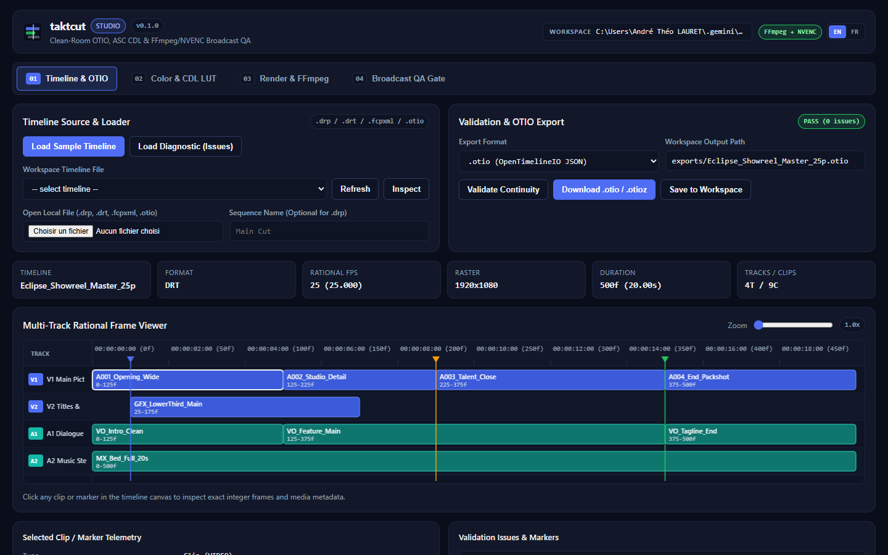
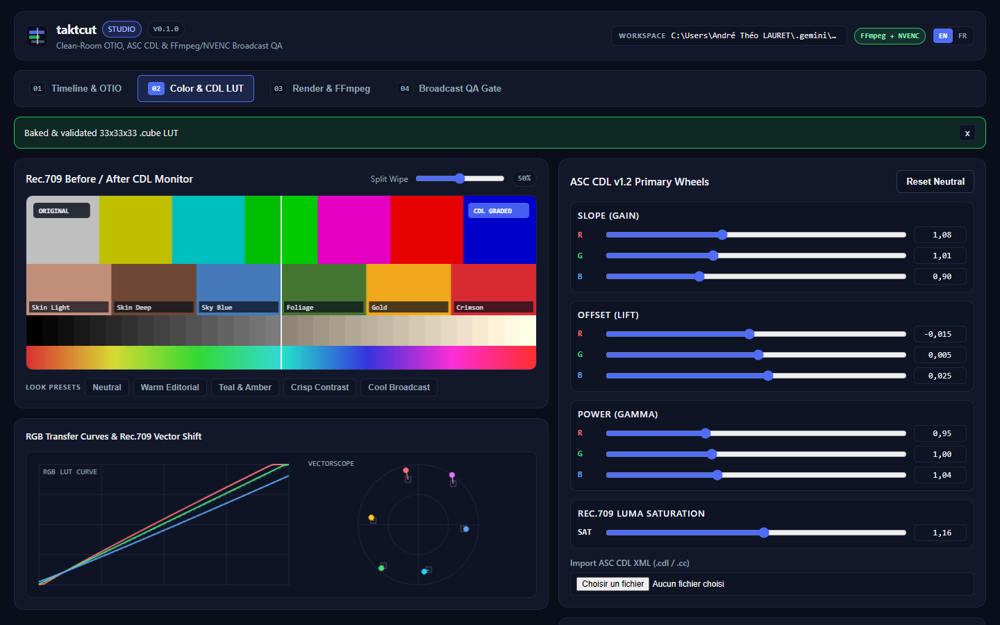
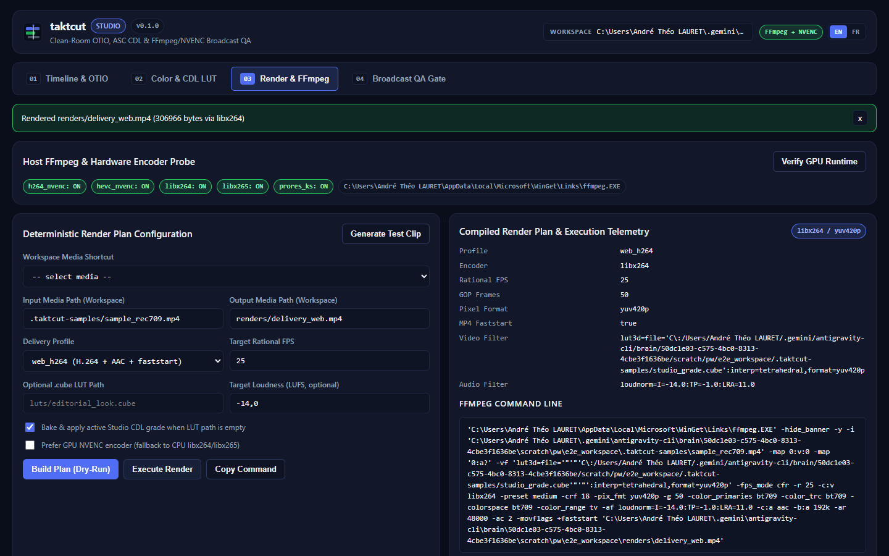
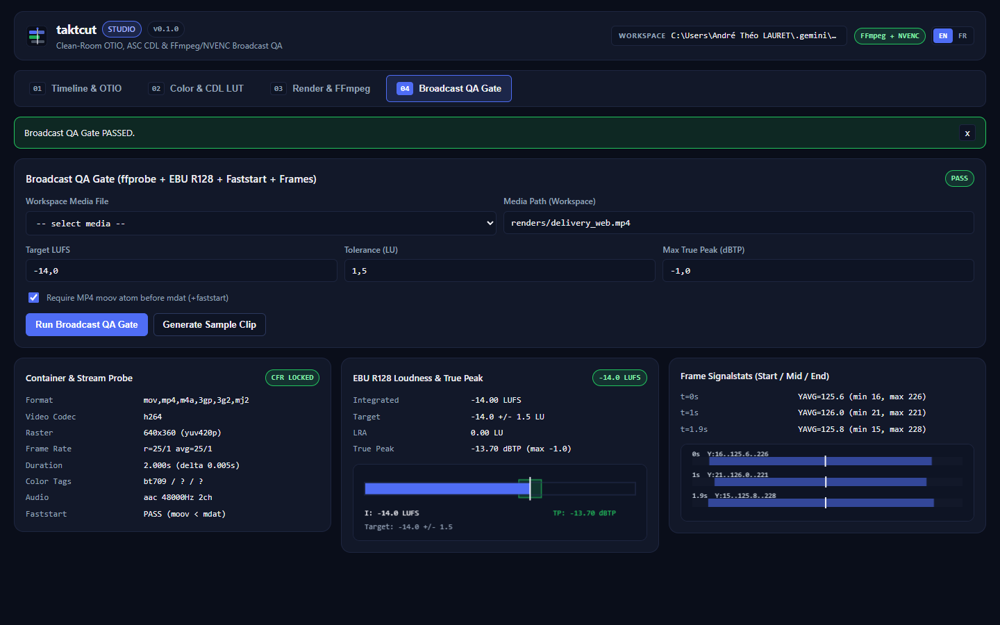
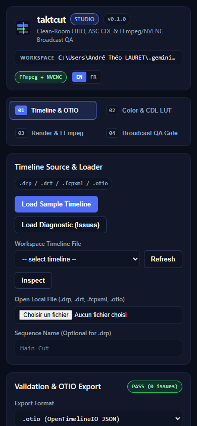

# Guide de l'Interface Graphique Web Studio

[English](../gui-guide.md) | [Francais](gui-guide.md) | [Accueil](index.md)

Le Web Studio `taktcut` offre aux monteurs, etalonneurs et charges de finition un acces visuel direct a toutes les fonctions de `taktcut`, sans ligne de commande.

## Lancer le Studio

Executez l'une de ces deux commandes depuis votre dossier de projet :

```bash
taktcut ui
# ou directement :
taktcut-ui
```

Options principales :
- `--workspace-dir CHEMIN` : Confine la navigation de fichiers, la sauvegarde de LUT `.cube`, les rendus et le controle QA a un dossier precis (par defaut le dossier courant).
- `--port 8741` : Port local d'ecoute (`0` choisit automatiquement un port libre).
- `--host 127.0.0.1` : Interface loopback uniquement (`127.0.0.1`, `localhost`, ou `::1`).
- `--no-open` : Demarre le serveur sans ouvrir automatiquement le navigateur.

En haut a droite, le bouton **EN / FR** bascule toute l'interface entre anglais et francais instantanement.

---

## Espace 1 : Timeline & OTIO



Inspectez vos projets DaVinci Resolve (`.drp`), timelines Resolve (`.drt`), exports Final Cut Pro (`.fcpxml`) ou fichiers OpenTimelineIO (`.otio`, `.otioz`).

### Etapes d'Utilisation

1. **Charger une Timeline** :
   - Cliquez sur **Charger Exemple Timeline** pour explorer un montage multi-pistes 25p (`V1`, `V2`, `A1`, `A2` et marqueurs), ou **Charger Exemple Diagnostic** pour visualiser la detection d'ecarts (gaps), chevauchements (overlaps), durees nulles et divergences de cadence.
   - Selectionnez un fichier dans **Fichier Timeline dans l'Espace** puis cliquez sur **Inspecter**.
   - Ou ouvrez un fichier local depuis votre disque via **Ouvrir Fichier Local**.
2. **Analyser les Trames Exactes** :
   - Le bandeau de telemetrie affiche le FPS rationnel exact (`25`, `24000/1001`, etc.), la definition, la duree totale en trames et le statut de continuite (`CONFORME` / `ECHEC`).
   - Utilisez le curseur **Zoom** et cliquez sur n'importe quel plan ou marqueur dans la visionneuse pour afficher ses trames entieres exactes (`start_frame`, `duration_frames`, `source_in_frame`, `source_path`).
3. **Exporter en OpenTimelineIO** :
   - Choisissez `.otio` ou `.otioz`.
   - Cliquez sur **Telecharger .otio / .otioz** ou saisissez un chemin relatif (ex. `exports/timeline.otio`) et cliquez sur **Enregistrer dans l'Espace**.

---

## Espace 2 : Couleur & LUT CDL



Reglez un etalonnage primaire ASC CDL v1.2 en temps reel sur mires et scopes Rec.709, puis exportez une LUT 3D `.cube` validee.

### Etapes d'Utilisation

1. **Regler l'Etalonnage Primaire** :
   - Ajustez **Slope (Gain)**, **Offset (Lift / Pied)**, **Power (Gamma)** par canal R/V/B et la **Saturation Luma Rec.709**, ou choisissez un pre-reglage (**Neutre**, **Editorial Chaud**, **Sarcelle & Ambre**, **Contraste Net**, **Froid Broadcast**).
   - Deplacez le curseur **Volet** sur le **Moniteur Rec.709 Avant / Apres CDL** pour comparer l'image brute et l'image etalonnee.
   - Observez les **Courbes RVB & Vecteur Rec.709** se mettre a jour en temps reel.
   - Vous pouvez egalement importer un fichier XML ASC CDL (`.cdl` / `.cc`).
2. **Generer & Exporter la LUT `.cube`** :
   - Definissez le **Titre de la LUT** et la taille de **Grille 3D** (`17`, `33` standard, ou `65`).
   - Cliquez sur **Generer & Valider .cube** pour calculer la table 3D via `bake_cdl_to_cube`, valider le format et afficher l'apercu.
   - Cliquez sur **Telecharger .cube** pour l'enregistrer sur votre poste, ou **Utiliser dans le Rendu** pour lier ce grade directement dans l'Espace 3.

---

## Espace 3 : Rendu & FFmpeg



Compilez une commande FFmpeg/NVENC deterministe avec verrouillage CFR, GOP = `2 * fps`, application de LUT `.cube` et normalisation EBU R128 optionnelle.

### Etapes d'Utilisation

1. **Verifier les Encodeurs Materiels** :
   - Le bandeau superieur indique les encodeurs disponibles (`h264_nvenc`, `hevc_nvenc`, `libx264`, `libx265`, `prores_ks`). Cliquez sur **Tester Runtime GPU** pour verifier l'initialisation NVENC reelle.
2. **Configurer le Plan de Rendu** :
   - Selectionnez un media dans **Raccourci Media de l'Espace** (ou cliquez sur **Generer Clip Test** pour creer un clip synthetique Rec.709 25fps + sinus 1kHz dans `.taktcut-samples/`).
   - Choisissez le **Profil de Livraison** (`web_h264`, `master_hevc`, ou `prores_hq`), le **FPS Rationnel Cible**, une LUT `.cube` (ou cochez **Appliquer le grade CDL actif du studio**) et la **Sonie Cible (LUFS)**.
3. **Previsualiser ou Executer** :
   - Cliquez sur **Construire Plan (Dry-Run)** pour inspecter la commande `ffmpeg` complete et ses filtres avant encodage.
   - Cliquez sur **Executer le Rendu**, puis sur **Lancer QA sur la Sortie** pour auditer le fichier genere dans l'Espace 4.

---

## Espace 4 : Portail QA Broadcast



Controlez vos livrables avant diffusion ou mise en ligne.

### Controles Executes

- **Audit Conteneur & Flux (`ffprobe`)** : Codec video, resolution, format de pixels, verrouillage CFR (`r_frame_rate` vs `avg_frame_rate`), ecart de duree conteneur/flux, balises Rec.709, flux audio et placement `+faststart` MP4 (`moov` avant `mdat`).
- **Sonie EBU R128 (`ebur128`)** : Mesure de la sonie integree (`LUFS`), plage dynamique (`LRA`) et pic reel (`dBTP`) compares a la cible et a la tolerance.
- **Statistiques Images (`signalstats`)** : Decodage controle au debut, au milieu et en fin de fichier avec niveaux de luminance (`YMIN`, `YAVG`, `YMAX`).

---

## Interface Mobile & Responsive



Tous les onglets s'adaptent sans debordement horizontal jusqu'aux ecrans `375px` pour controler vos timelines et rapports QA depuis n'importe quel format d'ecran.
