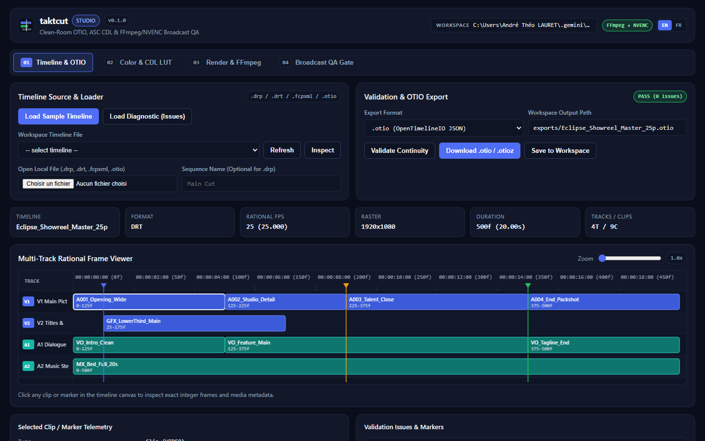
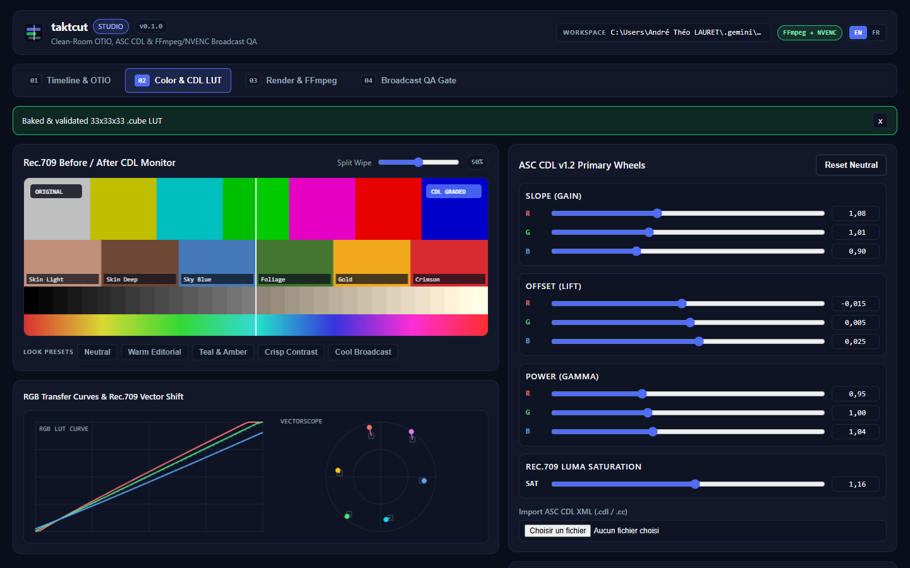
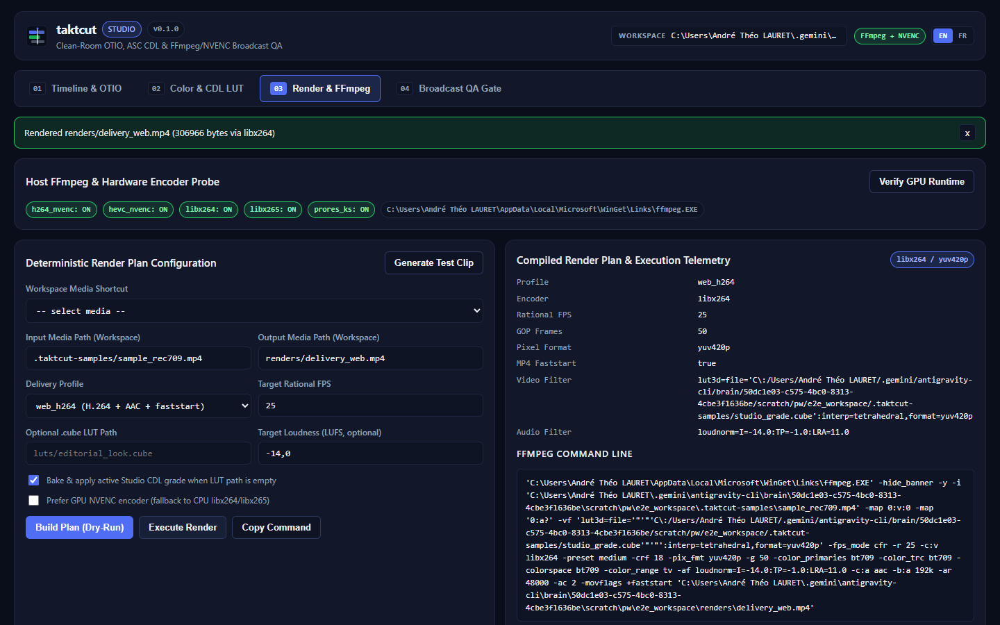
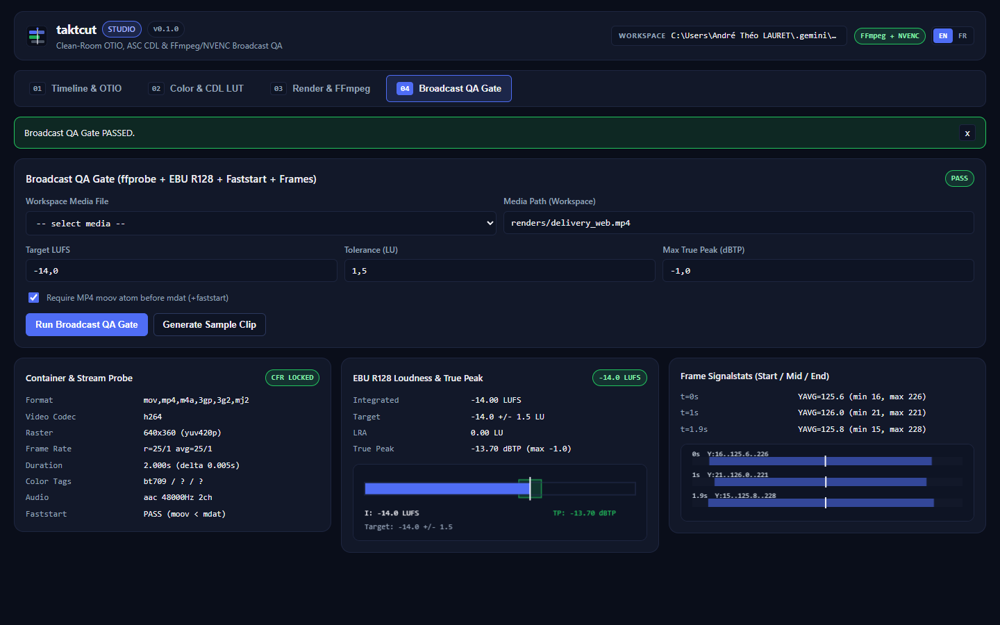
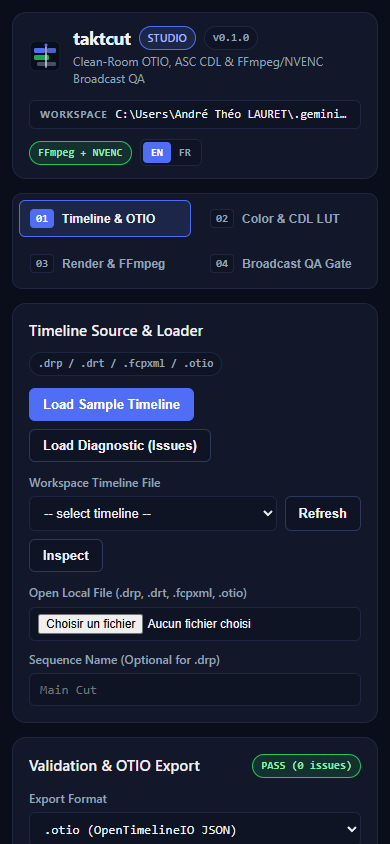

# Web Studio GUI Guide

[English](gui-guide.md) | [Francais](fr/gui-guide.md) | [Home](index.md)

The `taktcut` Web Studio gives editors, colorists, and finishing producers direct visual access to every core `taktcut` engine without writing scripts or terminal commands.

## Launching the Studio

Run either command from your project folder:

```bash
taktcut ui
# or standalone script:
taktcut-ui
```

Common options:
- `--workspace-dir PATH`: Restricts file browsing, renders, LUT saves, and QA checks to a specific project directory (defaults to your current working directory).
- `--port 8741`: Custom local port (`0` picks an available ephemeral port automatically).
- `--host 127.0.0.1`: Loopback host (`127.0.0.1`, `localhost`, or `::1` only).
- `--no-open`: Starts the server without opening a browser tab automatically.

At the top right of the studio header, you can switch between **EN** and **FR** at any time, see your active confined workspace path, and verify whether FFmpeg and NVIDIA NVENC are available.

---

## Workspace 1: Timeline & OTIO



Use this workspace to audit Resolve project archives (`.drp`), Resolve timeline exports (`.drt`), Final Cut Pro XML (`.fcpxml`), or existing OpenTimelineIO files (`.otio`, `.otioz`).

### Step-by-Step

1. **Load a Timeline**:
   - Click **Load Sample Timeline** to explore a clean 25p multi-track mastering cut (`V1`, `V2`, `A1`, `A2`, plus markers), or **Load Diagnostic (Issues)** to see how `taktcut` highlights gaps, overlaps, zero-duration clips, and framerate mismatches.
   - Select a file discovered inside your workspace via **Workspace Timeline File** and click **Inspect**.
   - Or open any local `.drp`, `.drt`, `.fcpxml`, or `.otio`/`.otioz` file directly from your computer with **Open Local File**.
2. **Inspect Rational Frame Math**:
   - The telemetry strip shows exact rational FPS (for example `24000/1001` or `25`), raster resolution, total integer frame duration, and validation status (`PASS` or `FAIL`).
   - Use the **Zoom** slider on the Multi-Track Rational Frame Viewer and click any clip or vertical marker pin to inspect exact integer `start_frame`, `duration_frames`, `source_in_frame`, and `source_path`.
3. **Export to OpenTimelineIO**:
   - Choose `.otio` (OpenTimelineIO JSON) or `.otioz` (compressed bundle).
   - Click **Download .otio / .otioz** to save directly via browser download, or enter a relative workspace path (such as `exports/showreel.otio`) and click **Save to Workspace**.

---

## Workspace 2: Color & CDL LUT



Build primary ASC CDL v1.2 grades interactively, verify them on real-time Rec.709 scopes, and bake validated 3D `.cube` LUTs.

### Step-by-Step

1. **Dial in Primary Grading**:
   - Adjust **Slope (Gain)**, **Offset (Lift)**, **Power (Gamma)** R/G/B channels and **Rec.709 Luma Saturation**, or pick one of the studio **Look Presets** (`Neutral`, `Warm Editorial`, `Teal & Amber`, `Crisp Contrast`, `Cool Broadcast`).
   - Drag the **Split Wipe** slider on the **Rec.709 Before / After CDL Monitor** to compare ungraded vs graded SMPTE bars, skin tones, foliage/sky patches, and luminance ramp.
   - Watch the **RGB Transfer Curves & Rec.709 Vector Shift** canvas update live as you tweak values.
   - Optionally import an existing `.cdl` / `.cc` XML file via **Import ASC CDL XML**.
2. **Bake & Export `.cube`**:
   - Set **LUT Title** and **3D Grid Size** (`17`, `33` standard, or `65`).
   - Click **Bake & Validate .cube** to run `bake_cdl_to_cube`, validate every entry, and preview the generated `.cube` header and table.
   - Click **Download .cube** to save locally, or click **Use in Render Plan** to carry your active grade straight into Workspace 3.

---

## Workspace 3: Render & FFmpeg



Compile deterministic Rec.709 FFmpeg/NVENC render commands with constant frame rate (CFR) locking, GOP = `2 * fps`, LUT baking, and optional EBU R128 loudness normalization.

### Step-by-Step

1. **Check Host Encoders**:
   - The top strip shows detected encoders (`h264_nvenc`, `hevc_nvenc`, `libx264`, `libx265`, `prores_ks`). Click **Verify GPU Runtime** to run a live NVENC initialization test.
2. **Configure Your Delivery Plan**:
   - Pick an input media file from **Workspace Media Shortcut** (or click **Generate Test Clip** to create a 2-second 25fps Rec.709 `testsrc2` + `1kHz` sine MP4 inside `.taktcut-samples/`).
   - Choose a **Delivery Profile** (`web_h264`, `master_hevc`, or `prores_hq`), **Target Rational FPS** (`25`, `24000/1001`, etc.), optional `.cube` LUT (or check **Bake & apply active Studio CDL grade**), and optional **Target Loudness (LUFS)**.
3. **Inspect or Execute**:
   - Click **Build Plan (Dry-Run)** to review the exact deterministic `argv` command line and filter graph without encoding.
   - Click **Execute Render** to run FFmpeg and inspect bytes written and return code. Once finished, click **Run QA Gate on Output** to send the deliverable directly to Workspace 4.

---

## Workspace 4: Broadcast QA Gate



Verify deliverables against streaming and broadcast specifications before handoff.

### Checks Performed

- **Container & Stream Probe (`ffprobe`)**: Verifies video codec, raster dimensions, pixel format, CFR vs VFR (`r_frame_rate` vs `avg_frame_rate`), duration parity, Rec.709 color tags, audio sample rate/channels, and MP4 `+faststart` (`moov` atom placed before `mdat`).
- **EBU R128 Loudness (`ebur128`)**: Measures integrated loudness (`LUFS`), loudness range (`LRA`), and true peak (`dBTP`) against your configured target, tolerance, and max true-peak ceiling.
- **Frame Signalstats**: Decodes frames at start, midpoint, and near-end to verify readability and luminance bounds (`YMIN`, `YAVG`, `YMAX`).

---

## Mobile & Responsive Layout



Every workspace adapts cleanly down to `375px` mobile screens with zero horizontal overflow so you can inspect timelines or check QA telemetry from tablets and phones on your local machine.
